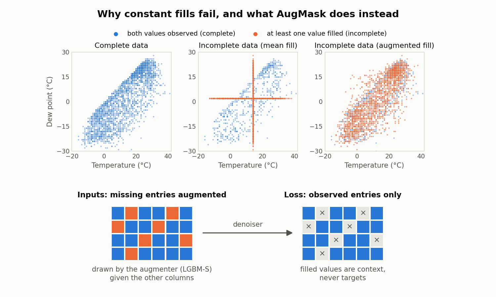

# AugMask

Official code for **AugMask: Training Diffusion Models on Incomplete Tabular Data via Stochastic Augmentation and Masking** (ICML 2026).
Jungkyu Kim, Taeyoung Park, Kibok Lee. [[arXiv]](https://arxiv.org/abs/2606.03347) [[OpenReview]](https://openreview.net/forum?id=Ot8lh7vvGe)

## Why AugMask

**Diffusion models for tabular data are built for complete rows**, but real tables have missing entries. The usual workarounds fail:

- **Constant fills become data.** Trained on mean-filled rows, the model learns the fills as real values. Below, filled rows collapse onto a cross at the means, and TabDiff then generates about half of its rows exactly there.
- **Masking the loss is not enough.** Filled entries left out of the loss are still read as inputs, so the model learns from rows that real data rarely contains, such as a hot day paired with the average dew point.

AugMask fixes both:

1. **Augment.** Each missing entry is filled once with a random draw from a model of its column given the other columns, so the inputs look like real data (right panel). This repository uses LGBM-S, a set of lightweight per-column LightGBM models, as the augmenter.
2. **Mask.** The denoising loss is computed on observed entries only, so the filled values give context but are never targets.

<picture>
  <source media="(prefers-color-scheme: dark)" srcset="assets/overview_dark.png">
  
</picture>

AugMask needs no change to the model itself. This repository applies it to three diffusion models: [TabDDPM](https://proceedings.mlr.press/v202/kotelnikov23a.html) (ICML 2023; [code](https://github.com/yandex-research/tab-ddpm)), [CDTD](https://proceedings.iclr.cc/paper_files/paper/2025/hash/61f4e5747b1b753cb35546b15d981f76-Abstract-Conference.html) (ICLR 2025; [code](https://github.com/muellermarkus/cdtd)) and [TabDiff](https://proceedings.iclr.cc/paper_files/paper/2025/hash/5c882988ce5fac487974ee4f415b96a9-Abstract-Conference.html) (ICLR 2025; [code](https://github.com/MinkaiXu/TabDiff)).

## Install

Python 3.10–3.12.

```bash
conda env create -f environment.yml && conda activate augmask   # the exact environment used for the results
# or
pip install -e ".[all]"                                          # everything (pip install -e . for the augmentation alone)
```

## Use AugMask with your own model

```python
from augmask import Encoded, LGBMSAugmenter

train = Encoded(X_num, X_cat, M_num, M_cat)
(X_num_filled, X_cat_filled), = LGBMSAugmenter().augment(train, [], n_categories)

# train your denoiser on the filled table, with the loss restricted to observed entries
loss = (per_entry_loss * mask).sum() / mask.sum()
```

The augmenter takes an encoded table with `n` rows:

| Input | Shape | Type | Content |
|---|---|---|---|
| `X_num` | `(n, d_num)` | float | numerical columns, quantile-normal transformed; `NaN` where missing |
| `X_cat` | `(n, d_cat)` | int | categorical columns, integer encoded as `0 … K_j−1`; `−1` where missing |
| `M_num`, `M_cat` | same as above | bool | `True` where observed |
| `n_categories` | `d_cat` | list of int | number of categories `K_j` of each categorical column |

It returns `X_num` and `X_cat` with every missing entry filled. In this repository the backbones then receive the filled `X_num` (float32, standardized), `X_cat` (int64 codes) and the masks, with the target as one of the columns (the first numerical column for regression, the first categorical column for classification).

### Your own augmenter

Any object with an `augment` method can replace LGBM-S:

```python
from augmask.run import run

class MyAugmenter:
    def augment(self, train, others, n_categories):
        # fit on `train` (an Encoded table); return [(X_num, X_cat), ...] for `train` and each of `others`,
        # with every missing entry filled: floats in X_num, codes 0 … K_j−1 in X_cat
        ...

run("adult", "mcar", 0.5, "tabdiff-augmask", augmenter=MyAugmenter())
```

## Run

Datasets are downloaded from UCI on first use.

```bash
# one method on one scenario: train, sample and evaluate  ->  runs/<dataset>/<mechanism>/p<p>/seed<s>/<method>.{csv,json}
python -m augmask.run --dataset adult --mechanism mcar --p 0.5 --method cdtd-augmask

# all experiments (6 datasets x 5 missing rates x 3 seeds x 14 methods) followed by the summary tables
bash scripts/run_all.sh 0                  # on GPU 0
bash scripts/run_all.sh 1 beijing news     # or split the datasets across GPUs and servers,
python scripts/make_tables.py              # then summarise the merged runs/
```

Methods are `{tabddpm,cdtd,tabdiff}-{noaug,meanmask,augfull,augmask}`, plus the baselines `forestdiff` and `miwae`.

| Strategy | Missing inputs filled with | Loss on |
|---|---|---|
| `noaug` | train mean / mode | all entries |
| `meanmask` | train mean / mode | observed entries (similar to [MissDiff](https://arxiv.org/abs/2307.00467); Ouyang et al., 2023) |
| `augfull` (ours) | augmented draws (LGBM-S) | all entries |
| `augmask` (ours) | augmented draws (LGBM-S) | observed entries |

**Masks and fills.** The first run of a scenario saves its missingness masks and augmented fills to `artifacts/<dataset>/<mechanism>/p<p>/seed<s>.npz`; later runs of the same scenario reuse them, so LGBM-S runs once per scenario rather than once per method.

**Runtime.** LGBM-S takes a few seconds per scenario (fit on the train split, fill train and validation; AMD Ryzen 9 5950X, 32 threads):

| Missing | Adult | Default | Shoppers | Magic | Beijing | News |
|---|---:|---:|---:|---:|---:|---:|
| 10% | 3.5 s | 2.0 s | 1.3 s | 0.3 s | 2.9 s | 5.7 s |
| 50% | 4.5 s | 2.3 s | 1.5 s | 0.3 s | 4.1 s | 4.9 s |
| 90% | 6.0 s | 2.0 s | 1.1 s | 0.3 s | 5.8 s | 2.9 s |

## Reference results

Adult and Beijing, MCAR with 50% and 90% missing, one seed, averaged over the four scenarios (×100, best in bold). Utility is downstream task performance: a model trained on synthetic rows and tested on real ones, relative to training on real rows.

Missing-aware: [ForestDiff](https://proceedings.mlr.press/v238/jolicoeur-martineau24a.html) (AISTATS 2024) and [MIWAE](https://proceedings.mlr.press/v97/mattei19a.html) (ICML 2019). Missing-unaware, trained with the four strategies above: [TabDDPM](https://proceedings.mlr.press/v202/kotelnikov23a.html) (ICML 2023), [CDTD](https://proceedings.iclr.cc/paper_files/paper/2025/hash/61f4e5747b1b753cb35546b15d981f76-Abstract-Conference.html) (ICLR 2025) and [TabDiff](https://proceedings.iclr.cc/paper_files/paper/2025/hash/5c882988ce5fac487974ee4f415b96a9-Abstract-Conference.html) (ICLR 2025).

| Method | Shape ↑ | Trend ↑ | α-Precision ↑ | β-Recall ↑ | Utility ↑ |
|---|---:|---:|---:|---:|---:|
| TabDDPM + NoAug | 68.2 | 54.7 | 45.1 | 8.7 | 66.0 |
| TabDDPM + MeanMask | 94.9 | 88.5 | 91.9 | 28.3 | 74.5 |
| TabDDPM + AugFull (ours) | 95.6 | 90.2 | 94.2 | 31.3 | 76.3 |
| TabDDPM + AugMask (ours) | 92.4 | 87.5 | 91.3 | 34.8 | 78.3 |
| CDTD + NoAug | — | — | — | — | — |
| CDTD + MeanMask | — | — | — | — | — |
| CDTD + AugFull (ours) | — | — | — | — | — |
| CDTD + AugMask (ours) | — | — | — | — | — |
| TabDiff + NoAug | 66.9 | 54.3 | 43.8 | 9.0 | 67.9 |
| TabDiff + MeanMask | 96.6 | 88.8 | 95.0 | 29.3 | 73.3 |
| TabDiff + AugFull (ours) | 95.8 | 91.3 | 93.3 | 32.1 | 76.0 |
| TabDiff + AugMask (ours) | **98.2** | **94.4** | **98.5** | **39.3** | **78.7** |
| ForestDiff | 69.7 | 66.7 | 65.6 | 22.4 | 66.4 |
| MIWAE | 97.5 | 85.2 | 97.1 | 29.1 | 72.4 |

"—": being rerun with the current training settings.

<details>
<summary>Per scenario</summary>

**Adult, 50% missing**

| Method | Shape ↑ | Trend ↑ | α-Precision ↑ | β-Recall ↑ | Utility ↑ |
|---|---:|---:|---:|---:|---:|
| TabDDPM + NoAug | 81.9 | 71.9 | 51.5 | 15.5 | 95.9 |
| TabDDPM + MeanMask | 94.7 | 89.7 | 90.8 | 30.9 | 97.3 |
| TabDDPM + AugFull (ours) | 96.9 | 93.1 | 98.1 | 35.7 | 96.8 |
| TabDDPM + AugMask (ours) | 97.1 | 94.6 | 98.1 | 44.0 | **97.7** |
| CDTD + NoAug | — | — | — | — | — |
| CDTD + MeanMask | — | — | — | — | — |
| CDTD + AugFull (ours) | — | — | — | — | — |
| CDTD + AugMask (ours) | — | — | — | — | — |
| TabDiff + NoAug | 81.0 | 72.3 | 50.8 | 15.9 | 95.1 |
| TabDiff + MeanMask | 96.2 | 93.6 | 96.1 | 35.7 | 97.5 |
| TabDiff + AugFull (ours) | 97.1 | 94.2 | 98.4 | 36.3 | 96.9 |
| TabDiff + AugMask (ours) | **99.2** | **97.7** | **98.6** | **46.3** | 97.6 |
| ForestDiff | 90.7 | 91.3 | 95.4 | 34.8 | 97.0 |
| MIWAE | 97.3 | 94.9 | 98.3 | 30.8 | 95.5 |

**Adult, 90% missing**

| Method | Shape ↑ | Trend ↑ | α-Precision ↑ | β-Recall ↑ | Utility ↑ |
|---|---:|---:|---:|---:|---:|
| TabDDPM + NoAug | 66.3 | 46.2 | 10.9 | 1.8 | 71.7 |
| TabDDPM + MeanMask | 94.6 | 85.4 | 92.9 | 11.8 | 93.7 |
| TabDDPM + AugFull (ours) | 94.6 | 84.8 | 96.1 | 13.3 | 94.1 |
| TabDDPM + AugMask (ours) | 91.8 | 83.7 | 93.5 | 30.1 | 94.8 |
| CDTD + NoAug | — | — | — | — | — |
| CDTD + MeanMask | — | — | — | — | — |
| CDTD + AugFull (ours) | — | — | — | — | — |
| CDTD + AugMask (ours) | — | — | — | — | — |
| TabDiff + NoAug | 65.9 | 47.1 | 10.5 | 1.8 | 78.9 |
| TabDiff + MeanMask | 95.5 | 87.2 | 90.9 | 10.3 | 91.6 |
| TabDiff + AugFull (ours) | 94.5 | 85.2 | 94.6 | 13.4 | 93.2 |
| TabDiff + AugMask (ours) | 97.5 | **91.1** | **97.7** | **33.6** | **95.4** |
| ForestDiff | 36.3 | 26.9 | 1.4 | 0.3 | 72.3 |
| MIWAE | **97.6** | 89.1 | 96.5 | 14.2 | 92.0 |

**Beijing, 50% missing**

| Method | Shape ↑ | Trend ↑ | α-Precision ↑ | β-Recall ↑ | Utility ↑ |
|---|---:|---:|---:|---:|---:|
| TabDDPM + NoAug | 74.2 | 64.1 | 70.3 | 15.9 | 50.5 |
| TabDDPM + MeanMask | 95.3 | 92.1 | 92.0 | 37.4 | 58.0 |
| TabDDPM + AugFull (ours) | 97.6 | 94.2 | 97.4 | 39.1 | 62.9 |
| TabDDPM + AugMask (ours) | 96.6 | 91.7 | 94.0 | 38.4 | 66.2 |
| CDTD + NoAug | — | — | — | — | — |
| CDTD + MeanMask | — | — | — | — | — |
| CDTD + AugFull (ours) | — | — | — | — | — |
| CDTD + AugMask (ours) | — | — | — | — | — |
| TabDiff + NoAug | 72.2 | 64.4 | 69.2 | 16.4 | 53.5 |
| TabDiff + MeanMask | 97.2 | 94.7 | 97.9 | 38.6 | 59.9 |
| TabDiff + AugFull (ours) | 97.7 | 95.5 | 96.1 | **40.2** | 62.9 |
| TabDiff + AugMask (ours) | **98.9** | **96.2** | **99.2** | 39.9 | **66.5** |
| ForestDiff | 91.9 | 90.6 | 93.1 | 35.1 | 62.4 |
| MIWAE | 97.8 | 87.1 | 97.2 | 39.2 | 58.3 |

**Beijing, 90% missing**

| Method | Shape ↑ | Trend ↑ | α-Precision ↑ | β-Recall ↑ | Utility ↑ |
|---|---:|---:|---:|---:|---:|
| TabDDPM + NoAug | 50.4 | 36.6 | 47.7 | 1.6 | 46.1 |
| TabDDPM + MeanMask | 94.9 | 86.6 | 91.7 | 33.3 | 49.1 |
| TabDDPM + AugFull (ours) | 93.5 | 88.8 | 85.0 | 37.2 | 51.4 |
| TabDDPM + AugMask (ours) | 84.2 | 79.8 | 79.6 | 26.6 | 54.5 |
| CDTD + NoAug | — | — | — | — | — |
| CDTD + MeanMask | — | — | — | — | — |
| CDTD + AugFull (ours) | — | — | — | — | — |
| CDTD + AugMask (ours) | — | — | — | — | — |
| TabDiff + NoAug | 48.6 | 33.7 | 44.9 | 1.8 | 44.3 |
| TabDiff + MeanMask | 97.4 | 79.8 | 95.2 | 32.3 | 44.3 |
| TabDiff + AugFull (ours) | 93.9 | 90.4 | 84.1 | **38.3** | 50.8 |
| TabDiff + AugMask (ours) | 97.3 | **92.6** | **98.6** | 37.6 | **55.4** |
| ForestDiff | 59.7 | 58.1 | 72.4 | 19.6 | 33.7 |
| MIWAE | **97.5** | 69.5 | 96.2 | 32.3 | 43.9 |

</details>

## Pipeline

1. **Collect** the six UCI tables (Adult, Default, Shoppers, Magic, Beijing, News).
2. **Split** each table 60/20/20 into train, validation and test.
3. **Mask** train and validation entries (the target included) completely at random (MCAR) or depending on the other columns (MAR); the test split stays complete.
4. **Encode**, using the observed train entries: numerical columns are quantile-normal transformed, categorical columns are integer encoded.
5. **Fill** the missing entries with the train mean / mode, or with augmented draws (LGBM-S by default).
6. **Standardize** the numerical columns.
7. **Train** the backbone and sample as many rows as the train split.
8. **Map** the samples back to the original columns and values.
9. **Evaluate** against the complete train and test splits: Shape, Trend, α-Precision, β-Recall and Utility (downstream task performance), following [TabSyn](https://proceedings.iclr.cc/paper_files/paper/2024/hash/e9750610639c3e7a849cff746bf60dbd-Abstract-Conference.html) (ICLR 2024).

<details>
<summary>Repository structure</summary>

```
augmask/
├── augment.py           # step 5: LGBM-S (Algorithm 1), mean/mode fill, the Augmenter interface
├── run.py               # one method on one scenario: build, train, sample, evaluate
├── evaluate.py          # step 9: Shape, Trend, α-Precision, β-Recall, Utility
├── data/
│   ├── datasets.py      # step 1: download and clean the six UCI tables
│   ├── split.py         # step 2: fixed stratified 60/20/20 split
│   ├── missingness.py   # step 3: MCAR and MAR masks
│   ├── transforms.py    # steps 4 and 6: quantile-normal, integer codes, standardization
│   ├── scenario.py      # steps 3-6 and 8 for one scenario; saves and loads masks and fills
│   └── schema.py        # column types, target and task
├── models/              # step 7
│   ├── tabddpm.py, cdtd.py, tabdiff.py   # the backbones, each with an optional loss mask
│   └── common.py        # seeding, batching, EMA
└── baselines/
    ├── forestdiff.py    # the official ForestDiffusion package, wrapped
    └── miwae.py
scripts/
├── run_all.sh           # all experiments, then the summary tables
├── make_tables.py       # rank tables with Wilcoxon markers
└── plot_overview.py     # the figure above
tests/                   # pipeline, missingness, baselines, evaluation, each backbone
```

</details>

## Notes on this release

The data pipeline was rebuilt for this release (60/20/20 split, a new MAR generator), so numbers differ slightly from the paper. Model and training settings follow Appendix C.6 of the paper, except that CDTD trains its full schedule and keeps the final weights instead of early stopping: its validation loss is noisy enough to stop some runs after 10% of training. LGBM-S follows Algorithm 1; `LGBMSAugmenter(log_var_offset=LOG_CHI2_BIAS)` optionally corrects the downward bias of its variance model.

LGBM-S is a per-coordinate augmenter: it draws each missing entry independently given the observed ones, so it does not model the dependence between entries that are missing together. An augmenter that samples the missing coordinates jointly is a natural direction for future work, and can be plugged in as described in [Your own augmenter](#your-own-augmenter).

## Citation

```bibtex
@inproceedings{kim2026augmask,
  title     = {{AugMask}: Training Diffusion Models on Incomplete Tabular Data via Stochastic Augmentation and Masking},
  author    = {Kim, Jungkyu and Park, Taeyoung and Lee, Kibok},
  booktitle = {Proceedings of the 43rd International Conference on Machine Learning},
  series    = {Proceedings of Machine Learning Research},
  volume    = {306},
  year      = {2026}
}
```

## Acknowledgements

The backbones are adapted from [TabDDPM](https://github.com/yandex-research/tab-ddpm), [CDTD](https://github.com/muellermarkus/cdtd) and [TabDiff](https://github.com/MinkaiXu/TabDiff) (MIT). The metrics follow [TabSyn](https://github.com/amazon-science/tabsyn) (Apache-2.0), α-Precision/β-Recall follow [synthcity](https://github.com/vanderschaarlab/synthcity), and MIWAE follows [hyperimpute](https://github.com/vanderschaarlab/hyperimpute) (MIT). ForestDiff uses the official [ForestDiffusion](https://github.com/SamsungSAILMontreal/ForestDiffusion) package.

Released under the MIT License.
